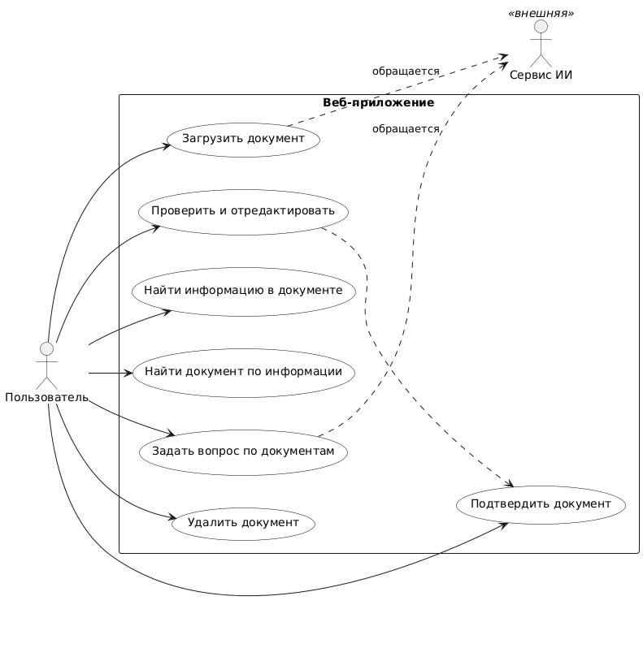
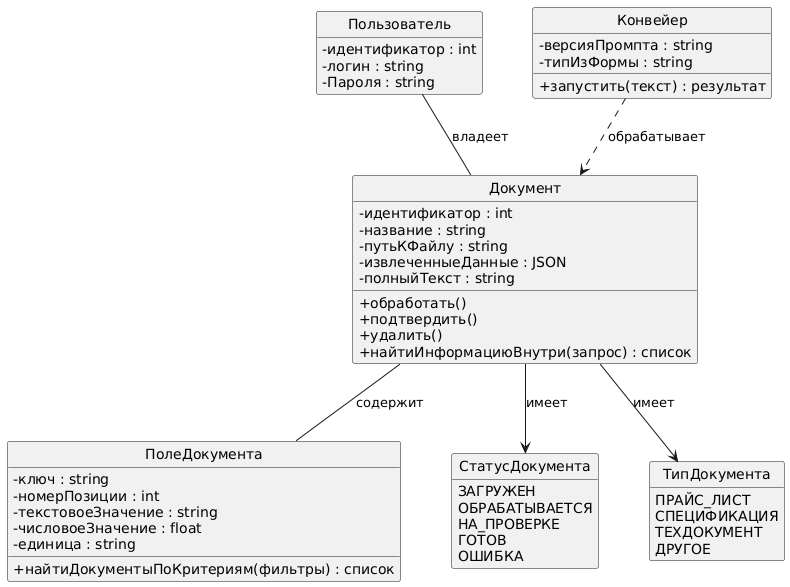
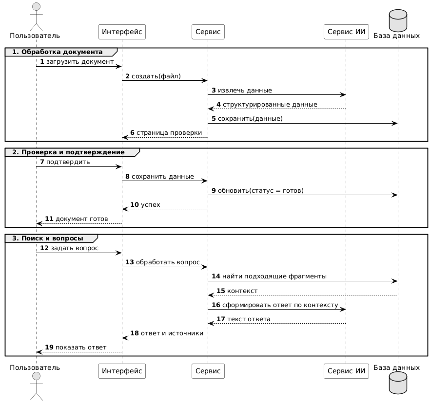
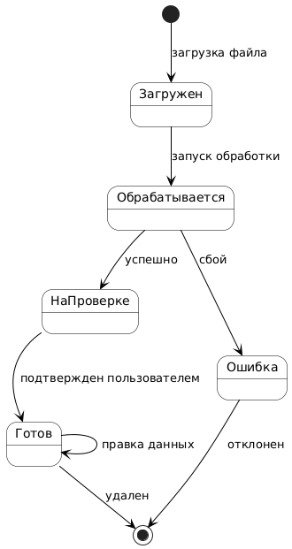
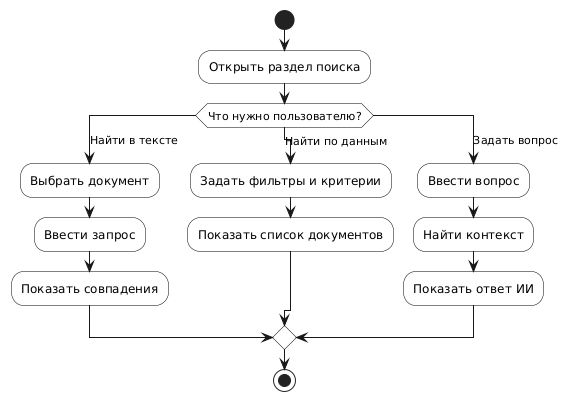

# ВКР: Веб-система автоматизированной обработки и поиска информации в обезличенных электронных документах

**Проект:** Expired Bread

## Предметная область

Разрабатывается веб-система для автоматизации процессов обработки и анализа электронных документов. Система обеспечивает загрузку файлов (PDF, DOCX), извлечение структурированных данных с использованием технологий искусственного интеллекта, проверку и корректировку данных оператором, а также многокритериальный поиск. Основными типами обрабатываемых документов являются прайс-листы, спецификации и техническая документация.

## UML-диаграммы

Исходные коды диаграмм на языке PlantUML размещены в директории `diagrams/`. Отрендеренные изображения находятся в директории `images/`.

### 1. Диаграмма вариантов использования (Use Case)

**Описание:** Диаграмма определяет функциональные границы системы. Представлены основные сценарии работы пользователя (загрузка, проверка, поиск, удаление, формирование вопросов) и взаимодействие системы с внешним «Сервисом ИИ» для извлечения данных.

### 2. Диаграмма классов (Classes)

**Описание:** Отражает статическую структуру приложения. Базовыми сущностями являются `Пользователь`, `Документ` и `ПолеДокумента`. Логика поиска (по критериям и по полному тексту) инкапсулирована в виде методов внутри соответствующих классов.

### 3. Диаграмма последовательности (Sequence)

**Описание:** Иллюстрирует динамическое поведение системы в рамках трех основных сценариев:
1. Обработка документа (взаимодействие интерфейса, сервиса документов, ИИ и базы данных).
2. Проверка и подтверждение данных пользователем.
3. Поиск и генерация ответа на вопрос по документам.

### 4. Диаграмма состояний (State)

**Описание:** Демонстрирует жизненный цикл документа. Переходы показывают, что документ становится доступен для поиска только после успешного завершения обработки и подтверждения пользователем.

### 5. Диаграмма деятельности (Activity)

**Описание:** Описывает алгоритм работы пользователя в разделе поиска. Процесс разделяется на три ветви: поиск информации внутри выбранного документа, поиск документов по заданным критериям и Q&A (формирование вопросов к базе документов).

## Программный код

На основе диаграммы классов разработан каркас программного кода на языке Python. Файл расположен по пути `generated/python_code.py`.


**Запуск кода:**
```bash
python3 generated/python_code.py